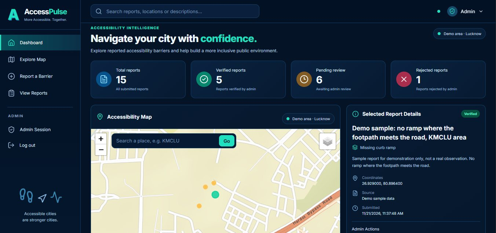

# AccessPulse

**AccessPulse** is a community web app for reporting and tracking accessibility barriers in public spaces: missing curb ramps, blocked footpaths, stairs with no ramp, broken sidewalks and inaccessible crossings. People submit reports, and administrators verify, prioritise and resolve them.

Built for **Prasunex Innovathon 2026** (Round 3, Prototype Development and Demonstration). The demo area is Lucknow.

> **Status:** working prototype. Implemented features and planned work are listed separately below.

- **Demo video:** https://drive.google.com/file/d/1sd5ApfGOw6kw_3SdKAQ8zOulsEAHfFbl/view
- **Source code:** https://github.com/rupeshkesarwani8-byte/AccessPulse



## Important note about the data

This is a demonstration project. The reports in the demo are **sample data**: one is based on a news report, and the others are labelled "Demo sample". Map markers show submitted reports, not certified accessible routes. The data must not be treated as an authoritative accessibility dataset.

## Implemented features

**For everyone**

- Interactive map with three base layers: Esri street, OpenStreetMap and satellite.
- Place search that moves the map to a landmark (OpenStreetMap Nominatim, plus a few custom places).
- Report form with title, barrier type, description, source and coordinates. Coordinates come from a map click, manual entry or the device location.
- Optional photo (JPEG or PNG, up to 5 MB). The server re-encodes the photo, which removes EXIF data such as GPS location.
- Warning when a similar report (same barrier type, within 50 m) already exists. This check runs in the browser.
- Dashboard with totals, a barrier type chart, search, and filters by status and barrier type.
- Map markers coloured by status, with a legend.

**For administrators**

- Login with a signed token. Credentials come from backend environment variables.
- Review actions: verify, reject, resolve and reopen. Invalid status changes are refused with HTTP 409.
- Status history saved for every change (who and when).
- Repair priority score from 0 to 100, with the breakdown shown (see below).
- CSV export, with protection against spreadsheet formula injection.
- Bulk import of reports from a CSV file (`backend/scripts/import_reports.py`).

**Interface accessibility**

- Skip link, keyboard access to map markers (Tab and Enter), visible focus rings, screen reader announcements for messages, and reduced motion support.
- A browser accessibility audit (Lighthouse, automated) scored 100 on the dashboard. Automated checks do not replace testing with real users.

## Status flow

```
pending  ->  verified  ->  resolved
pending  ->  rejected   (final)
resolved ->  verified   (reopen)
```

## Repair priority score

Only pending and verified reports are ranked. The score is 0 to 100:

| Part | Maximum | How it is calculated |
|---|---|---|
| Severity | 50 | By barrier type: inaccessible crossing 5, missing ramp 5, blocked path 4, stairs 4, broken sidewalk 3, other 2 |
| Nearby reports | 20 | 4 points for each other active report within 100 m (up to 5) |
| Review status | 15 | Verified 15, pending 5 |
| Waiting time | 15 | Full score after 30 days |

The severity weights are our own judgement, not an official standard.

## Technology stack

**Frontend:** React, Vite, JavaScript, CSS, Leaflet, React Leaflet, Recharts, Lucide React
**Backend:** Python, FastAPI, SQLAlchemy, Pydantic, Pillow, Uvicorn
**Database:** SQLite
**Tests:** pytest with FastAPI TestClient (24 tests)
**Map tiles:** Esri World Street, OpenStreetMap, Esri World Imagery

## Project structure

```text
AccessPulse-New/
├── frontend/
│   ├── index.html            # landing page
│   ├── app.html              # React app entry
│   ├── public/shots/         # screenshots used by the landing page
│   └── src/
│       ├── App.jsx
│       ├── App.css
│       ├── main.jsx
│       └── services/api.js
└── backend/
    ├── .env.example          # placeholders only
    ├── requirements.txt
    ├── app/
    │   ├── main.py
    │   ├── database.py
    │   ├── models/report.py      # Report, ReportPhoto, StatusHistory
    │   ├── schemas/report.py
    │   ├── services/priority.py  # repair priority score
    │   └── routes/
    │       ├── auth.py
    │       └── reports.py
    ├── scripts/
    │   ├── import_reports.py
    │   └── lucknow_reports_starter.csv
    └── tests/
        ├── test_photos.py
        └── test_priority.py
```

The local database (`backend/accesspulse.db`), `backend/.env` and uploaded photos (`backend/uploads/`) are created on your machine and are not part of the repository.

## Local setup (Windows / PowerShell)

### Prerequisites

- Python
- Node.js and npm

### 1. Start the backend

```powershell
cd backend
python -m venv .venv
.\.venv\Scripts\Activate.ps1
pip install -r requirements.txt
```

If PowerShell blocks script execution, allow it for the current terminal session only:

```powershell
Set-ExecutionPolicy -Scope Process RemoteSigned
.\.venv\Scripts\Activate.ps1
```

Create `backend/.env` (copy `.env.example`) with your own values:

```dotenv
ACCESSPULSE_ADMIN_USERNAME=your_admin_username
ACCESSPULSE_ADMIN_PASSWORD=your_strong_admin_password
ACCESSPULSE_SECRET_KEY=replace_with_a_long_random_secret
```

Start FastAPI:

```powershell
uvicorn app.main:app --reload
```

- API: `http://127.0.0.1:8000`
- Health: `http://127.0.0.1:8000/api/health`
- Interactive API docs: `http://127.0.0.1:8000/docs`

Keep this terminal running.

### 2. Start the frontend

Open a second terminal:

```powershell
cd frontend
npm install
npm run dev
```

Open `http://localhost:5173`. The landing page opens first, and **Open the app** goes to the app (`/app.html`). If PowerShell blocks `npm.ps1`, use `npm.cmd install` and `npm.cmd run dev`.

## Tests

```powershell
cd backend
pip install httpx2
python -m pytest tests
```

Expected result: 24 passed (photo upload, status rules and the priority score).

## Import reports from a CSV file

With the backend running:

```powershell
cd backend
python scripts/import_reports.py scripts/lucknow_reports_starter.csv --dry-run
python scripts/import_reports.py scripts/lucknow_reports_starter.csv
```

The header must be exactly `name,latitude,longitude,type,description,source`. The importer checks the same limits as the API, rejects locations outside the Lucknow area (this catches swapped coordinates), skips a report if an active report of the same type is within 50 m, and imports rows as `pending`. Back up `accesspulse.db` before a real import.

## API overview

| Method | Endpoint | Purpose | Access |
|---|---|---|---|
| `GET` | `/api/health` | Check backend health | Public |
| `GET` | `/api/reports` | List reports (filters: status, type, search) | Public |
| `POST` | `/api/reports` | Create a report (starts as pending) | Public |
| `POST` | `/api/reports/{id}/photo` | Upload a photo for a report | Public |
| `GET` | `/api/photos/{filename}` | Get a stored photo | Public |
| `PATCH` | `/api/reports/{id}/status` | Verify, reject or resolve | Admin |
| `GET` | `/api/reports/{id}/history` | Status history of one report | Admin |
| `GET` | `/api/priority` | Reports ranked by repair priority | Admin |
| `GET` | `/api/reports/export.csv` | CSV export | Admin |
| `GET` | `/api/stats` | Dashboard statistics | Public |

Report types: `missing_ramp`, `blocked_path`, `stairs`, `broken_sidewalk`, `inaccessible_crossing`, `other`.

## Limitations

- Photos are not blurred. Faces and number plates are not hidden automatically, so reporters are asked to avoid them.
- The duplicate warning runs in the browser. The server does not enforce it yet.
- "Verified" means an administrator reviewed the report. It is not a professional accessibility inspection.
- Data is stored in a local SQLite database and the app is not deployed publicly.
- The admin token is stored in browser `localStorage`. This is convenient for a demo but has security trade-offs.

## Security notes

- Keep `backend/.env` private. Never publish admin credentials, secret keys or tokens.
- Review HTTPS, authorization, validation, CORS, logging and secret management before any public deployment. The current setup is not production ready.

## Planned improvements

- [ ] Automatic blurring of faces and number plates in photos
- [ ] Server side duplicate check
- [ ] Verification by more than one reviewer
- [ ] Move to PostgreSQL and host publicly, with photo storage outside the app server
- [ ] Hindi and English interface
- [ ] Share verified reports with local authorities

## Author

Rupesh Kumar Kesarwani, B.Tech CSE (2nd year), Khwaja Moinuddin Chishti Language University (KMCLU), Lucknow.